# Nodegrants user guide

Nodegrants lets you decide, node by node, which roles and which individual
users may view, edit or delete a piece of content. It sits on top of Drupal's
normal content permissions: you switch it on for a content type, choose
defaults for that type, and then adjust the grants for each node from the
node's own edit form.

This guide walks through a typical setup. The screenshots were taken on
Drupal 12 with the Default Admin theme and the Navigation toolbar. On Drupal 11
with Claro the pages look a little different, but the forms and options are
the same.

## Contents

1. [Install the module](#1-install-the-module)
2. [Choose which roles can receive grants](#2-choose-which-roles-can-receive-grants)
3. [Turn Nodegrants on for a content type](#3-turn-nodegrants-on-for-a-content-type)
4. [Rebuild content access permissions](#4-rebuild-content-access-permissions)
5. [Set grants on a node](#5-set-grants-on-a-node)
6. [Grant access to individual users](#6-grant-access-to-individual-users)
7. [What users see](#7-what-users-see)
8. [The Nodegrants administration page](#8-the-nodegrants-administration-page)
9. [Drush command](#9-drush-command)
10. [How access is decided](#10-how-access-is-decided)
11. [Troubleshooting](#11-troubleshooting)

## 1. Install the module

Install with Composer and enable it with Drush:

```
composer require drupal/nodegrants
drush en nodegrants
```

You can also enable it from **Extend** (`/admin/modules`). It is listed under
*Access control*.

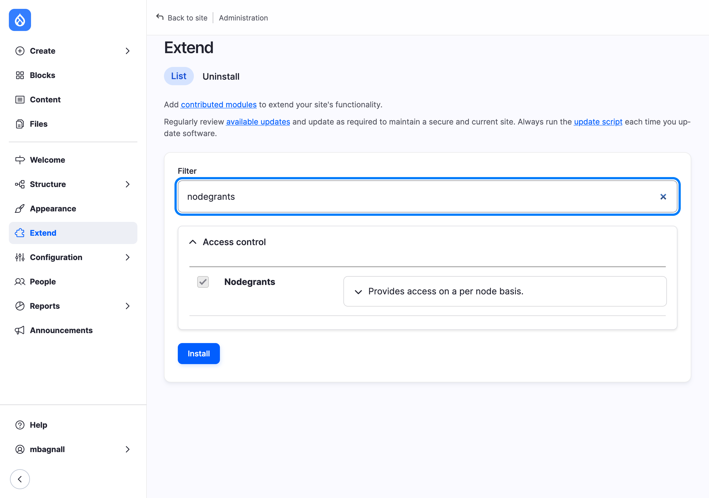

> Nodegrants conflicts with the legacy `drupal/nodeaccess` package from
> Drupal.org. Uninstall and remove that package before installing this one.

When the module is installed it builds a *role map* (a numeric ID for every
role) and seeds default grants for each existing content type from the roles'
current content permissions. Nothing changes for your content until you turn
the module on for a content type (step 3).

## 2. Choose which roles can receive grants

Go to **People > Permissions** and filter by module, or open
`/admin/people/permissions/module/nodegrants` directly. The module defines
three permissions.

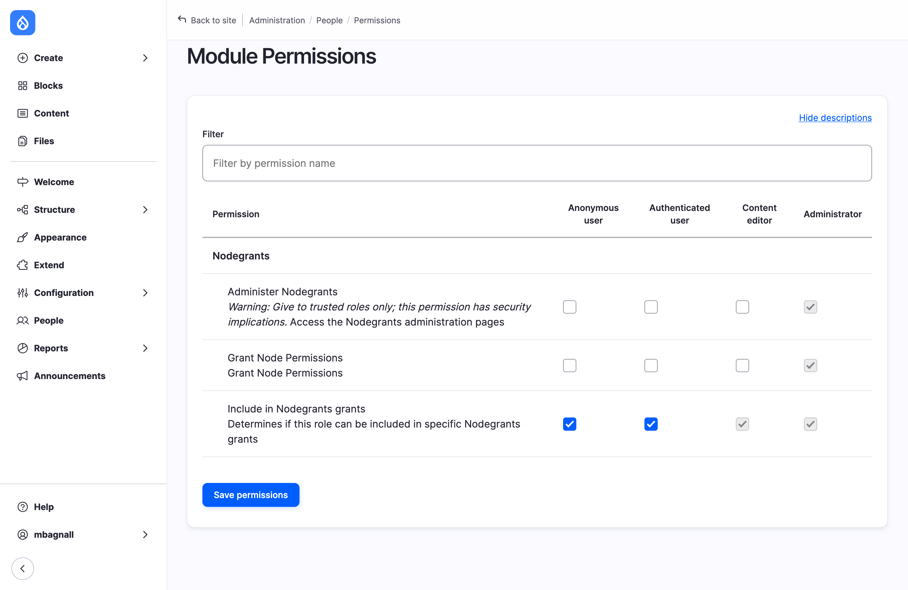

| Permission | Give it to | What it does |
|---|---|---|
| **Administer Nodegrants** | Site administrators only | Opens the Nodegrants administration page (step 8). It is also required to use the *remove* link next to a user on a node form (step 6). |
| **Grant Node Permissions** | Roles that manage who can see content, such as editors | Shows the Nodegrants pane on node add and edit forms and allows the user search in that pane. Without it, the pane is hidden and saving a node leaves its grants untouched. |
| **Include in Nodegrants grants** | Every role that should be selectable on a node | A role appears as a row in the Nodegrants pane only when it has this permission. Roles without it never get per-node grants. |

In the screenshot above, *Anonymous user* and *Authenticated user* both have
**Include in Nodegrants grants**, so every role on the site appears in the
per-node pane.

> If you give **Include in Nodegrants grants** to *Authenticated user*, every
> role is listed in the pane whether or not it has the permission itself,
> because every signed-in user also has the Authenticated user role.

## 3. Turn Nodegrants on for a content type

Nodegrants is off for every content type until you switch it on. Go to
**Structure > Content types**, edit the content type, and open the
**Nodegrants** tab at the bottom of the settings tabs.

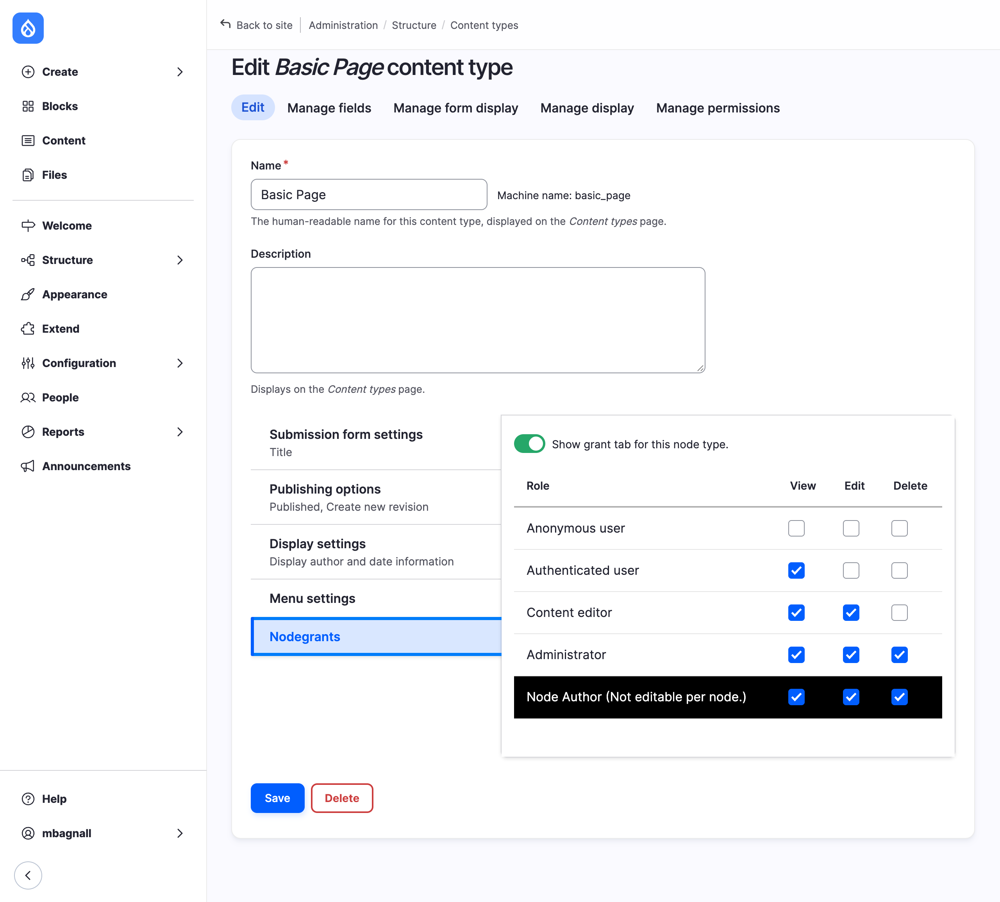

Switch on **Show grant tab for this node type** and set the defaults for each
role, then save the content type.

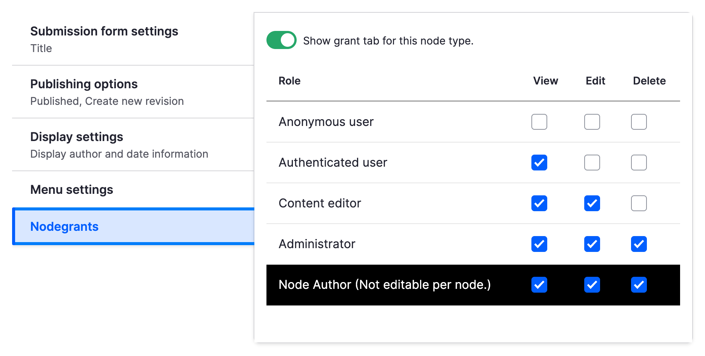

What each part means:

- **Show grant tab for this node type** is the master switch. While it is on,
  the Nodegrants pane appears on this type's node forms and the grants stored
  for its nodes are enforced. Switching it off hides the pane and ignores the
  stored grants, so the type's nodes go back to Drupal's normal content
  permissions. Switching it on again brings the stored grants back. Either
  change on an existing content type needs a rebuild of content access
  permissions (step 4).
- **The role rows** are the starting values for the Nodegrants pane. A new
  node, or a node that has never been saved through the pane, shows these
  boxes already ticked. They are defaults only: a node is not restricted by
  them until someone saves it through the pane.
- **Node Author (Not editable per node.)** sets what the node's owner may do
  on nodes that are under Nodegrants control. It always applies to the node's
  current owner, so it follows the node when the author is changed, and it is
  not shown on the node form. If you leave *Edit* unticked here, authors lose
  the ability to edit their own restricted nodes unless one of their roles has
  it.

In the example above, *Content editor* can view and edit, *Administrator* can
do everything, signed-in users can only view, anonymous visitors get nothing,
and the author keeps full control of their own nodes.

## 4. Rebuild content access permissions

Drupal keeps a copy of every node's grants in a lookup table. Saving a node
through the Nodegrants pane updates that node's rows straight away, but
switching Nodegrants on or off for a content type changes what the table
should contain for every node of that type. Drupal therefore asks you to
rebuild the table, and shows this notice on the status report until you do:


Go to **Reports > Status report**. The *Node Access Permissions* row has a
**Rebuild permissions** link:

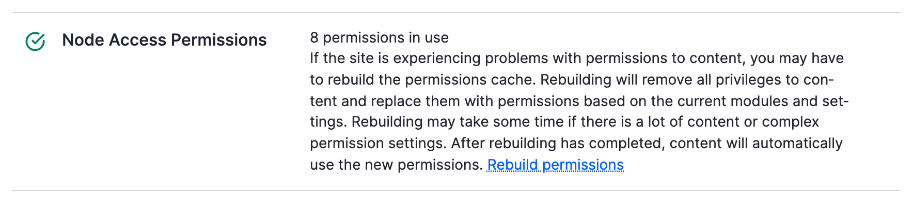

The link opens a confirmation form at `/admin/reports/status/rebuild`. Press
**Rebuild permissions** to run it.

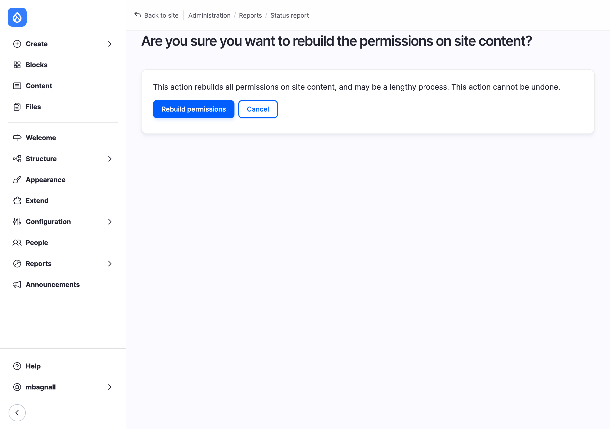

You can run the same rebuild from the command line with the module's Drush
command (step 9). Rebuilding visits every node on the site, so on very large
sites it takes a while and the web form runs it as a batch.

Rebuild whenever:

- you switched **Show grant tab for this node type** on or off for an
  existing content type;
- the status report says the permissions need to be rebuilt;
- content appears to be visible, or hidden, when it should not be.

## 5. Set grants on a node

Once a content type is switched on, every add and edit form for that type
gets a **Nodegrants** pane. In Claro and Default Admin it sits in the
right-hand sidebar; in other themes it appears at the top of the form. The
pane is collapsed by default. Click its title to open it.

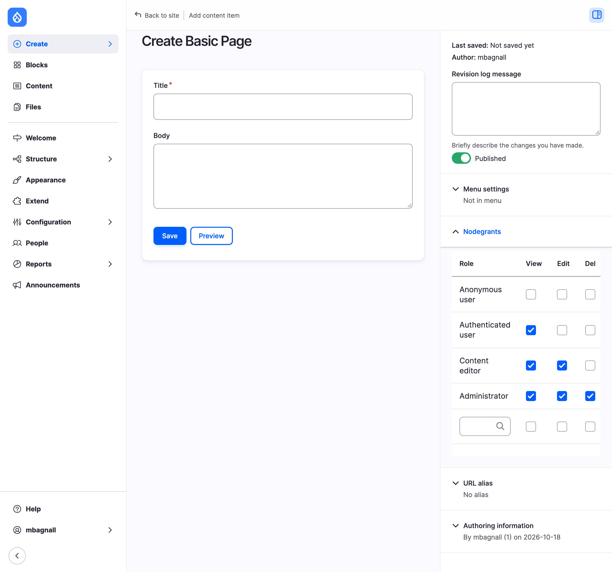

The pane is a table with one row per role and three boxes per row:

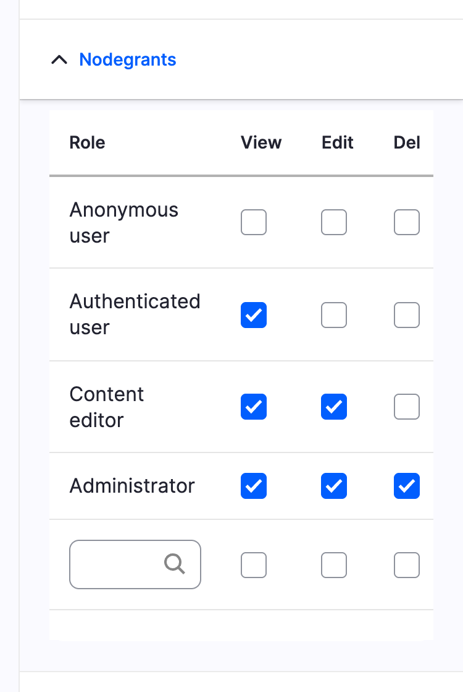

| Column | Lets the role... |
|---|---|
| **View** | see the node, and find it in listings and search results |
| **Edit** | open the node's edit form and save changes |
| **Del** | delete the node |

On a new node the boxes start from the content type defaults. Tick or untick
what this node needs, fill in the rest of the form and press **Save**. Saving
the form writes the grants and puts the node under Nodegrants control: from
then on only the ticked boxes (plus the author defaults from the content type,
and administrators who bypass content access) decide who can view, edit or
delete it.

A few things to know:

- Only users with **Grant Node Permissions** see the pane. Anyone else can
  still edit the node if they are allowed to, and their save leaves the
  grants exactly as they were.
- There is no per-node off switch. A node that has been saved through the
  pane stays under Nodegrants control. To open it up again, tick *View* for
  *Anonymous user* and *Authenticated user* and save.
- Nodes created before the content type was switched on, or saved only by
  users who cannot see the pane, are not under Nodegrants control yet. They
  follow Drupal's normal content permissions until someone saves them through
  the pane. The pane shows the content type defaults for such nodes.

## 6. Grant access to individual users

The last row of the pane is a user search. Start typing a username and pick
the account from the suggestions. The field fills in as `name [id]`, which is
the format the module expects.

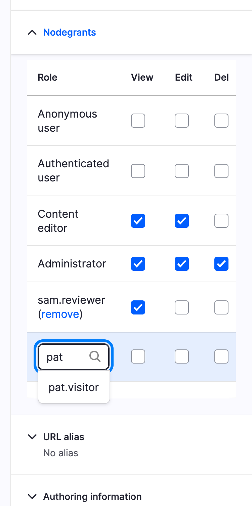

Tick the boxes for that user in the same row and save the node. The user now
has their own row in the pane with a **remove** link, as *sam.reviewer* does
in the screenshot below. Repeat to add more users, one per save.

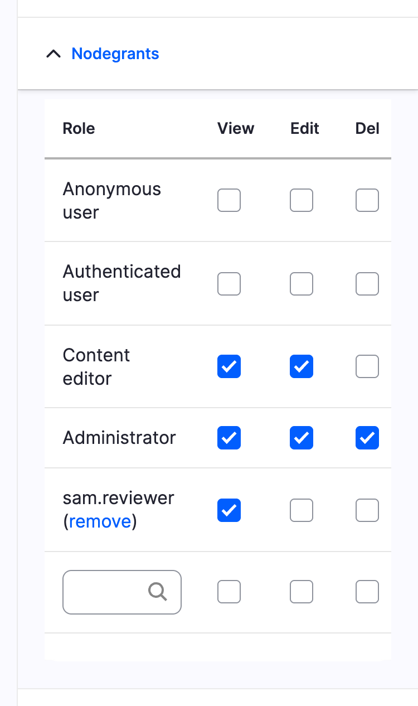

To change what a listed user may do, tick or untick the boxes in their row and
save the node. To take a user off the node, click **remove**. The removal
happens immediately, with no confirmation, and reloads the edit form. Other
changes you made on the form are not saved, so save them first.

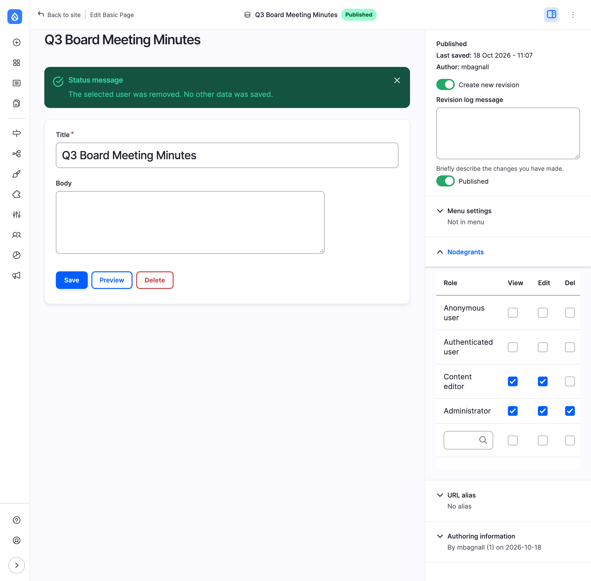

Notes:

- The **remove** link needs the **Administer Nodegrants** permission.
  Users with only *Grant Node Permissions* get *Access denied* from it. They
  can still untick all of a user's boxes instead.
- Accounts that already have a row on the node are left out of the
  suggestions. If you type one in by hand anyway, the form refuses to save
  and asks you to change that user's row instead.
- The search matches on username only, and shows at most ten accounts.
- Users are matched to grants by account ID, so renaming an account keeps its
  grants.

## 7. What users see

Suppose a *Basic page* called **Q3 Board Meeting Minutes** has these grants:

| Row | View | Edit | Del |
|---|---|---|---|
| Anonymous user | | | |
| Authenticated user | | | |
| Content editor | ✓ | ✓ | |
| Administrator | ✓ | ✓ | ✓ |
| sam.reviewer (user) | ✓ | | |

A signed-in user with no matching role and no user row, such as
*pat.visitor*, gets an *Access denied* page:

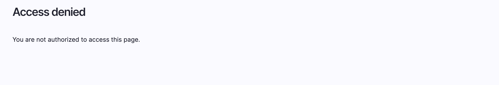

*sam.reviewer*, who has only the Authenticated user role but a user row with
*View* ticked, can read the page but not edit it:

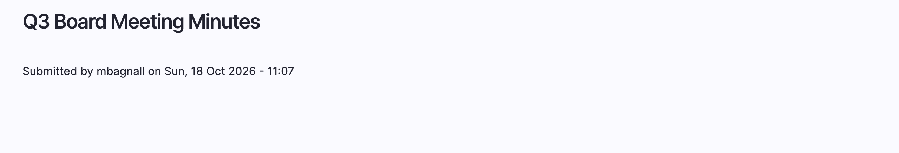

A *Content editor* can read and edit it but not delete it, and an
administrator can do all three. The node also disappears from listings, search
results and menus for users who cannot view it, because Drupal applies the
same grants to queries.

## 8. The Nodegrants administration page

The administration page is listed under **Structure** as **Nodegrants**, at
`/admin/structure/nodegrants`. It needs the **Administer Nodegrants**
permission.

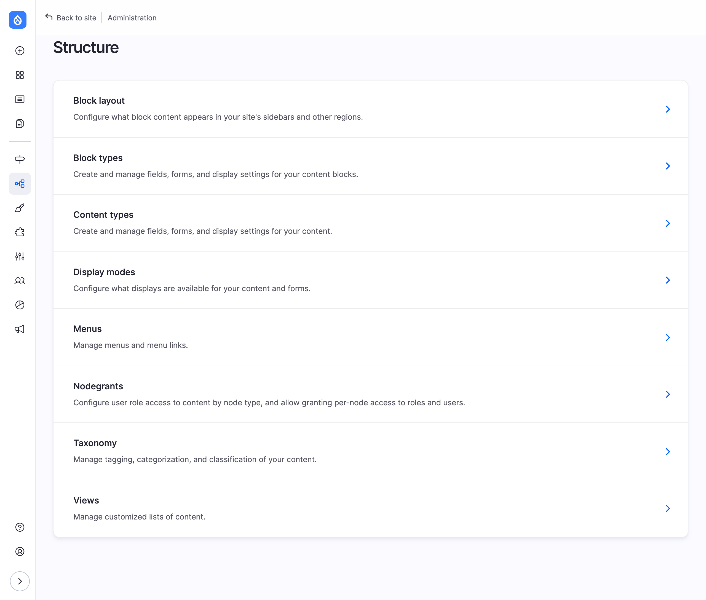

The page shows the role map: the numeric grant ID assigned to each role. The
map is maintained automatically when roles are added or deleted, so normally
there is nothing to do here.

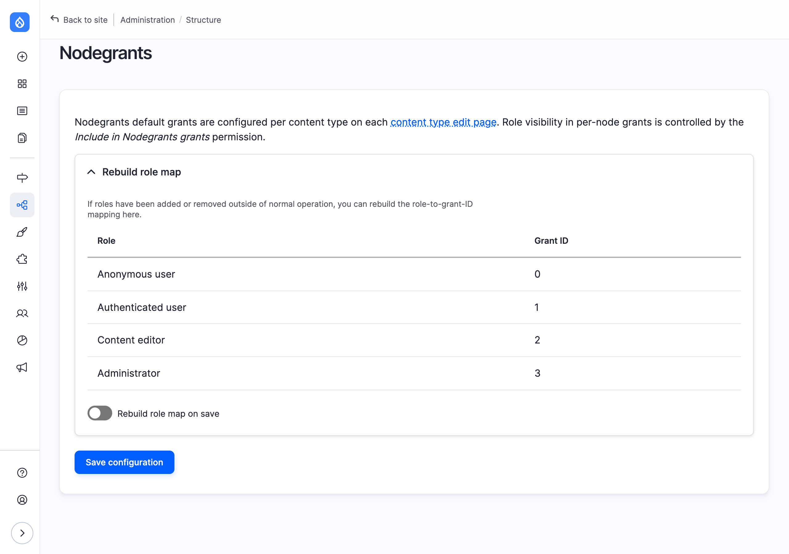

If a role is missing from the map, for example because roles were imported
with configuration while the module was uninstalled, open **Rebuild role
map**, tick **Rebuild role map on save** and press **Save configuration**.

> Rebuilding assigns IDs from scratch in role order. If the order differs
> from the original map, grants already stored on nodes can end up attached
> to a different role. Only rebuild when the map is actually wrong, run a
> content access rebuild afterwards (step 4), and spot-check a few restricted
> nodes.

## 9. Drush command

The module ships one Drush command, which does the same as the **Rebuild
permissions** button on the status report. It needs Drush 13.7 or later.

```
drush nodegrants:rebuild
drush ng:rebuild
```

Output:

```
[OK] Content access permissions have been rebuilt.
```

It rebuilds in one process rather than a batch, so on sites with a very large
number of nodes it can take a while to return.

## 10. How access is decided

These rules decide what a given person may do with a node.

1. Users with the core **Bypass content access control** permission (which
   the Administrator role has) can always view, edit and delete everything.
   Nodegrants never restricts them.
2. If the node's content type has **Show grant tab for this node type**
   switched off, or the node has never been saved through the Nodegrants
   pane, Drupal's normal content permissions apply. Nodegrants only mirrors
   the *View published content* permission for viewing.
3. Otherwise the node is under Nodegrants control:
   - **View** is allowed if any ticked *View* box matches the user: one of
     their roles, their own user row, or the content type's author default
     when they own the node. Matches add up, so one matching row is enough.
   - **Edit** and **Del** are checked in this order. If the user has their own
     row on the node, that row decides and their roles are not consulted. If
     not, any of their roles with the box ticked allows the action. In both
     cases the owner also gets whatever the content type's author default
     allows.
   - Anything not allowed by those rules is denied.

Because a user row takes precedence for editing and deleting, adding someone
with only *View* ticked stops them editing the node even if one of their
roles could. Tick *Edit* in their row if that is not what you want.

## 11. Troubleshooting

**The Nodegrants pane is missing from a node form.** Check that **Show grant
tab for this node type** is on for that content type (step 3) and that your
role has **Grant Node Permissions** (step 2). In themes other than Claro and
Default Admin, look for the pane at the top of the form instead of the
sidebar.

**A role is missing from the pane.** Give it **Include in Nodegrants grants**
(step 2), or give that permission to *Authenticated user* to list every role.

**I switched Nodegrants on or off for a content type and nothing changed.**
Rebuild content access permissions (step 4).

**Saving shows "The user-specific permissions could not be assigned."** The
user field did not contain a value in the `name [id]` form, usually because
the name was typed by hand rather than picked from the suggestions. Pick the
account from the list and save again.

**Saving shows "… already has grants on this node."** That account already
has a row in the pane. Change the boxes in that row instead of adding it
again.

**The remove link gives Access denied.** Removing a user needs **Administer
Nodegrants**. Without it, untick all of the user's boxes and save instead.

**Someone can still see a node they should not.** They may have **Bypass
content access control**, one of their roles may have *View* ticked, they may
own the node and the author default allows viewing, or the access table may
be stale. Rebuild permissions (step 4) and check each row in the pane.

**I want a restricted node to be public again.** Tick *View* for *Anonymous
user* and *Authenticated user* in the pane and save the node.
